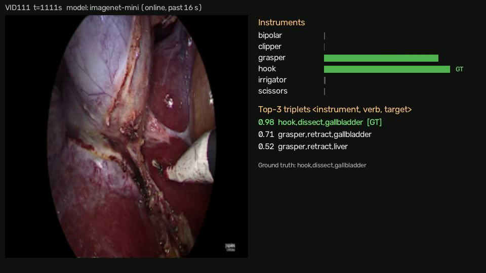
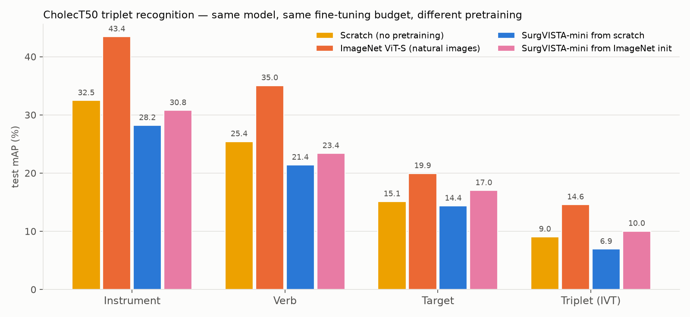
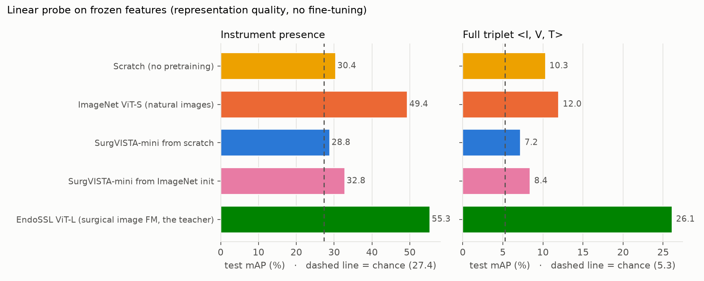

# SurgVISTA mini reproduction

A small-scale re-implementation of **SurgVISTA**, from *Large-scale self-supervised video foundation model for intelligent
surgery* (Yang et al., npj Digital Medicine 2026; [arXiv 2506.02692](https://arxiv.org/abs/2506.02692);
official code [isyangshu/SurgVISTA](https://github.com/isyangshu/SurgVISTA)). It was evaluated on CholecT50
action-triplet recognition.

This repo reproduces the **method** and tests the **direction** of the paper's claims on a single GTX 1070 (8 GB) in
about two hours of compute. That is roughly 1/1000 of the paper's data scale, so it does **not** reproduce the
paper's absolute numbers.



## What is reproduced

SurgVISTA pretrains a video ViT with two objectives:

1. **Masked video reconstruction.** Tube masking at a ratio of 0.85; the encoder sees visible tokens only. A
   depth-4 decoder regresses the normalised pixels of the masked cubes (MSE, weight 1.0).
2. **Image-expert distillation.** A depth-2, width-384 decoder regresses frame-level features of a frozen surgical
   image foundation model, EndoSSL ViT-L/16 (SmoothL1, weight 0.05).

| | Paper | Here |
|---|---|---|
| Backbone | ViT-B, 224 px | ViT-S, 112 px |
| Clip | 16 frames, stride 4 | 16 frames, stride 1 (1 fps) |
| Masking / decoders / losses / optimiser | official `pretrain.sh` | same values |
| Teacher | EndoSSL ViT-L | same checkpoint (authors' release); features cached once, since the teacher is frozen |
| Pretraining data | 3,650 videos, 3.55 M frames, 200 epochs | 40 CholecT50 train videos, 3,113 frames, 16 epochs |
| Downstream | 13 datasets | CholecT50 triplet recognition (one of the 13) |

**Data.** Four frame-index shards of [Voxel51/cholect50](https://huggingface.co/datasets/Voxel51/cholect50) give
four ~20 s windows (1 fps) from each of the 50 videos. The split is by video: the test set is the 10 videos of
CholecT50 cross-validation fold 1 (2, 6, 14, 23, 25, 50, 51, 66, 79, 111), and pretraining never sees them.
Recognition is online: a prediction at frame *t* uses only the 16 preceding frames.

## Results

All numbers below are generated by the scripts and copied from `04_finetune/output/`. Single seed, equal
fine-tuning budget per arm.

### End-to-end fine-tuning (4 epochs, identical recipe)

| Initialisation | mAP_I | mAP_V | mAP_T | **mAP_IVT** | best mAP_IVT | SCR@top5 | latency (ms) | epochs |
|---|---|---|---|---|---|---|---|---|
| Scratch (no pretraining) | 32.5 | 25.4 | 15.1 | **9.0** | 9.0 | 44.6 | 11 | 4 |
| ImageNet ViT-S (natural images) | 43.4 | 35.0 | 19.9 | **14.6** | 14.6 | 51.8 | 11 | 4 |
| SurgVISTA-mini from scratch | 28.2 | 21.4 | 14.4 | **6.9** | 7.6 | 25.3 | 11 | 4 |
| SurgVISTA-mini from ImageNet init | 30.8 | 23.4 | 17.0 | **10.0** | 10.5 | 27.7 | 11 | 4 |

mAP is computed over classes present in the test subset (I: instrument, V: verb, T: target, IVT: full triplet).
SCR@top5 is the share of the 166 safety-critical test frames (triplets on the cystic artery, cystic duct or a
blood vessel) whose true triplet is in the model's top 5. Latency is one online prediction: a 16-frame clip,
batch 1, fp32, on a GTX 1070.



### Linear probe on frozen features

| Encoder | mAP_I | mAP_V | mAP_T | mAP_IVT |
|---|---|---|---|---|
| Chance (test prevalence) | 27.4 | 20.1 | 10.7 | 5.3 |
| Random-init video ViT-S | 30.4 | 21.7 | 13.5 | 10.3 |
| ImageNet ViT-S (natural images) | 49.4 | 35.5 | 22.9 | 12.0 |
| SurgVISTA-mini from scratch | 28.8 | 21.3 | 17.0 | 7.2 |
| SurgVISTA-mini from ImageNet init | 32.8 | 25.9 | 15.0 | 8.4 |
| EndoSSL ViT-L (surgical image FM = teacher, 300 M params) | 55.3 | 46.4 | 40.4 | 26.1 |



### Interpretation

- **The premise holds.** The surgical-domain image model that SurgVISTA distills from (EndoSSL ViT-L) beats
  ImageNet features on every label group of the linear probe (triplet mAP 26.1 vs 12.0). Domain-specific
  pretraining at scale beats natural-image pretraining.
- **The video-SSL gain does not appear at this scale.** After 16 epochs on 3,113 frames, the SurgVISTA-mini encoder
  probes near chance. After fine-tuning it lands slightly below random initialisation. The reconstruction loss
  plateaus within a few epochs (`03_pretrain/output/surgvista_log.csv`): the decoder learns the "average endoscopic
  frame" rather than content (`03_pretrain/output/surgvista_recon.png`). Masked video modelling needs long schedules
  and large data; the paper's smallest scaling setting is already far larger than this subset.
- **Short continued pretraining from ImageNet hurts.** Pretraining from ImageNet weights lowers both pretraining
  losses. However, it erodes ImageNet's features: the instrument probe drops from 49.4 to 32.8, and fine-tuned
  triplet mAP drops from 14.6 to 10.0.

**Limitations.** Single seed; 788 test frames from 10 videos; only part of the 100 triplet classes occur in the
test subset. Read differences under ~2 mAP as noise. The four 20 s windows under-sample each procedure.

## Repository layout

```
_shared/        model (surgvista_mini.py), clip sampling (clips.py), config.yaml, run_pipeline.sh
02_data/        build_index.py  -> output/index.csv, classes.json, data_summary.md
03_pretrain/    extract_teacher.py, pretrain.py  -> output/ loss logs, reconstructions, curves
04_finetune/    finetune.py, linear_probe.py, summarize.py  -> output/ metrics, results.md, figures
05_demo/        demo.py  (online triplet recognition with a live overlay)
```

Heavy files (frames, cached teacher features, checkpoints) go to `work/`, which is git-ignored.

## Run it

Run all commands from the repo root. Tested with Python 3.11, torch 2.9.1+cu126, Windows, GTX 1070.

```sh
pip install torch==2.9.1 torchvision==0.24.1 --index-url https://download.pytorch.org/whl/cu126
pip install -r requirements.txt
```

**1. Data.** Download `samples.json` and the four shards into `work/data/cholect50/`:

```sh
hf download Voxel51/cholect50 --repo-type dataset --local-dir work/data/cholect50 \
  --include "samples.json" "data/005/*" "data/030/*" "data/055/*" "data/080/*"
```

**2. Teacher.** Download the EndoSSL ViT-L checkpoint released by the SurgVISTA authors (Google Drive id in
`_shared/config.yaml`):

```sh
pip install gdown
gdown 1bazW3W5Cglzfeeh_pdJALLktfxpateJ6 -O work/ckpt/teacher_endossl_vitl.pth
```

**3. Pipeline.** Runs data → teacher features → pretraining (2 variants) → fine-tuning (4 arms) → linear probe →
summary → demo. It takes about 75 min on a GTX 1070:

```sh
sh _shared/run_pipeline.sh            # or: PYTHON=/path/to/python sh _shared/run_pipeline.sh
```

You can also run single steps:

```sh
python 03_pretrain/pretrain.py --variant surgvista [--init-from imagenet]
python 04_finetune/finetune.py --init {scratch|imagenet|surgvista|surgvista_in}
python 04_finetune/linear_probe.py
python 04_finetune/summarize.py
python 05_demo/demo.py --init imagenet --video 111 --show    # or --mp4 any_laparoscopic_clip.mp4
```

Notes: Pascal GPUs (sm_61) need cu126 wheels, because torch ≥ 2.8 cu128 dropped them. Pascal has no fast fp16, so
everything trains in fp32.

## Data and licences

CholecT50 (Nwoye et al., 2022) is distributed under CC BY-NC-SA 4.0. The label index in `02_data/output/` is
derived from it, and no video frames are included. The teacher checkpoint and the SurgVISTA method belong to their
authors. Please cite the original papers:

```bibtex
@article{yang2026surgvista,
  title   = {Large-scale self-supervised video foundation model for intelligent surgery},
  author  = {Yang, Shu and others},
  journal = {npj Digital Medicine},
  year    = {2026}
}
```
